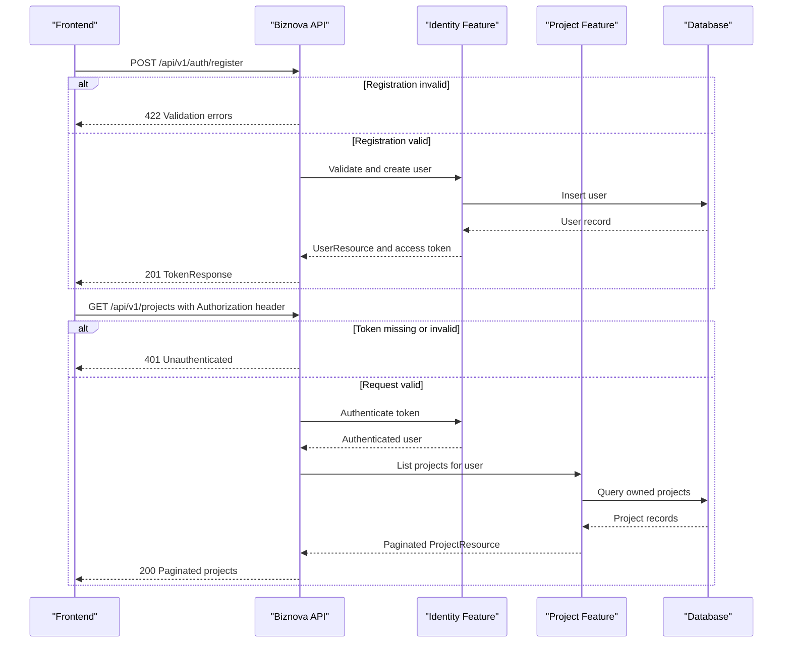

# API & Service Communication Contracts

L’API expose 33 routes REST synchrones sous `/api/v1` et échange des requêtes/réponses JSON. Ce document décrit les contrats implémentés pour guider les équipes frontend et backend ; toute fonctionnalité mentionnée comme non exposée nécessite un endpoint et un contrat avant son intégration côté frontend.

## Service Catalog

| Service | Port | Category | Purpose |
|---|---:|---|---|
| Biznova API | 8000 en local (`artisan serve`) | API Layer / Business | API REST versionnée pour l’identité, les références, les projets et la gestion financière. |

## API Endpoints Inventory

Base URL locale : `http://127.0.0.1:8000/api/v1`. Les exemples et contrats ci-dessous supposent des corps JSON (`Content-Type: application/json`) et des réponses JSON. Les routes protégées exigent un en-tête `Authorization` utilisant le schéma Bearer et la valeur `access_token` reçue à la connexion.

| Service | Méthode | Chemin | Requête | Réponse de succès |
|---|---|---|---|---|
| System | GET | `/health` | Aucune | `200` `{"status":"ok"}` |
| Identity | POST | `/auth/register` | `RegisterRequest` | `201` `TokenResponse` |
| Identity | POST | `/auth/login` | `LoginRequest` | `200` `TokenResponse` |
| Identity | POST | `/auth/logout` | Jeton d’accès | `204`, corps vide |
| Identity | GET | `/auth/profile` | Jeton d’accès | `200` `UserResource` |
| Identity | PATCH | `/auth/profile` | `UpdateProfileRequest` | `200` `UserResource` |
| ReferenceData | GET | `/sectors` | Aucune | `200` `data: Sector[]` |
| ReferenceData | GET | `/categories` | Query optionnelle : `sector_id`, `type` | `200` `data: Category[]` |
| ProjectAnalysis | GET | `/projects` | Jeton d’accès, query `page` optionnelle | `200` `ProjectResource[]` paginés |
| ProjectAnalysis | POST | `/projects` | `StoreProjectRequest` | `201` `ProjectResource` |
| ProjectAnalysis | GET | `/projects/{project}` | Jeton d’accès | `200` `ProjectResource` |
| ProjectAnalysis | PUT ou PATCH | `/projects/{project}` | `UpdateProjectRequest` | `200` `ProjectResource` |
| ProjectAnalysis | DELETE | `/projects/{project}` | Jeton d’accès | `204`, corps vide |
| BusinessFinance | GET | `/companies` | Jeton d’accès, query `page` optionnelle | `200` `CompanyResource[]` paginés |
| BusinessFinance | POST | `/companies` | `StoreCompanyRequest` | `201` `CompanyResource` |
| BusinessFinance | GET | `/companies/{company}` | Jeton d’accès | `200` `CompanyResource` |
| BusinessFinance | PUT ou PATCH | `/companies/{company}` | `UpdateCompanyRequest` | `200` `CompanyResource` |
| BusinessFinance | DELETE | `/companies/{company}` | Jeton d’accès | `204`, corps vide |
| BusinessFinance | GET | `/companies/{company}/operations` | Jeton d’accès, query `page` optionnelle | `200` `FinancialOperationResource[]` paginés |
| BusinessFinance | POST | `/companies/{company}/operations` | `StoreFinancialOperationRequest` | `201` `FinancialOperationResource` |
| BusinessFinance | GET | `/companies/{company}/operations/{operation}` | Jeton d’accès | `200` `FinancialOperationResource` |
| BusinessFinance | PUT ou PATCH | `/companies/{company}/operations/{operation}` | `UpdateFinancialOperationRequest` | `200` `FinancialOperationResource` |
| BusinessFinance | DELETE | `/companies/{company}/operations/{operation}` | Jeton d’accès | `204`, corps vide |
| BusinessFinance | GET | `/companies/{company}/tags` | Jeton d’accès, query `page` optionnelle | `200` `TagResource[]` paginés |
| BusinessFinance | POST | `/companies/{company}/tags` | `{"label": string}` | `201` `TagResource` |
| BusinessFinance | GET | `/companies/{company}/tags/{tag}` | Jeton d’accès | `200` `TagResource` |
| BusinessFinance | PUT ou PATCH | `/companies/{company}/tags/{tag}` | `{"label"?: string}` | `200` `TagResource` |
| BusinessFinance | DELETE | `/companies/{company}/tags/{tag}` | Jeton d’accès | `204`, corps vide |
| BusinessFinance | GET | `/companies/{company}/budgets` | Jeton d’accès, query `page` optionnelle | `200` `MonthlyBudgetResource[]` paginés |
| BusinessFinance | POST | `/companies/{company}/budgets` | `{"year": integer, "month": integer, "amount": number}` | `201` `MonthlyBudgetResource` |
| BusinessFinance | GET | `/companies/{company}/budgets/{monthlyBudget}` | Jeton d’accès | `200` `MonthlyBudgetResource` |
| BusinessFinance | PUT ou PATCH | `/companies/{company}/budgets/{monthlyBudget}` | `{"year"?: integer, "month"?: integer, "amount"?: number}` | `200` `MonthlyBudgetResource` |
| BusinessFinance | DELETE | `/companies/{company}/budgets/{monthlyBudget}` | Bearer token | `204`, corps vide |

Les paramètres `{project}`, `{company}`, `{operation}`, `{tag}` et `{monthlyBudget}` sont des identifiants numériques. Un identifiant appartenant à un autre utilisateur ou un enfant n’appartenant pas à l’entreprise de l’URL renvoie `404`.

## Management & Observability Endpoints

| Service | Endpoint | Custom Metrics |
|---|---|---|
| Biznova API | `GET /api/v1/health` | Aucun ; retourne `{"status":"ok"}`. |
| Laravel | `GET /up` | Endpoint de santé Laravel configuré au démarrage ; aucune métrique applicative exposée. |

## DTOs & Contracts

Les ressources ci-dessous sont les formes JSON de sortie faisant autorité. Les ressources d’un élément sont enveloppées dans `data`; les listes paginées suivent la forme Laravel `data`, `links` et `meta`. Les classes `FormRequest` contrôlent les entrées, mais ne sont pas les formes des réponses. Les `JsonResource` sont des transformateurs de réponse, pas des DTO immuables dédiés. Les identifiants sont des entiers, les dates métier `YYYY-MM-DD`, les horodatages ISO-8601, et les montants décimaux sont renvoyés comme chaînes à deux décimales.

### Identité et authentification

`UserResource` est utilisé pour le profil et l’utilisateur inclus dans l’authentification :

```json
{
  "data": {
    "id": 42,
    "first_name": "Aïcha",
    "last_name": "Diallo",
    "email": "aicha@example.com",
    "created_at": "2026-11-12T08:30:00.000000Z",
    "updated_at": "2026-11-12T08:30:00.000000Z"
  }
}
```

Le mot de passe n’est jamais renvoyé. L’inscription (`RegisterRequest`) prend `first_name` et `last_name` (chaînes), `email` (adresse email), `password` (chaîne d’au moins 8 caractères), `password_confirmation` (confirmation exacte) et `device_name` (chaîne). L’email est normalisé en minuscules et doit être unique. La connexion (`LoginRequest`) prend `email`, `password` et `device_name`. La mise à jour de profil (`UpdateProfileRequest`) accepte partiellement `first_name`, `last_name` ou `email`; l’email doit rester unique. Les deux réponses d’authentification ont cette forme (`201` à l’inscription, `200` à la connexion) :

```json
{
  "data": {
    "user": {
      "id": 42,
      "first_name": "Aïcha",
      "last_name": "Diallo",
      "email": "aicha@example.com",
      "created_at": "2026-11-12T08:30:00.000000Z",
      "updated_at": "2026-11-12T08:30:00.000000Z"
    },
    "access_token": "plain-text-token",
    "token_type": "Bearer"
  }
}
```

`UpdateProfileRequest` accepte une ou plusieurs des propriétés `first_name`, `last_name`, `email`. `GET` et `PATCH /auth/profile` retournent l’objet `UserResource` avec l’enveloppe `data`.

### Référentiels

- `Sector` : `{ "id": integer, "code": string, "label": string }`.
- `Category` : `{ "id": integer, "sector_id": integer|null, "type": "income"|"expense", "label": string, "is_active": boolean }`. La liste ne comprend que les catégories actives. Avec `sector_id`, elle inclut les catégories du secteur et celles communes (`sector_id: null`); `type` filtre le type.

### Projets

`StoreProjectRequest` exige `sector_id` (entier), `name` (chaîne, 150 caractères maximum), `launch_date` (date), et `activity_mode` (chaîne). `horizon_months` (entier de 6 à 60), `country` (chaîne ou `null`) et `currency` (chaîne de 3 caractères) sont optionnels. `UpdateProjectRequest` accepte ces propriétés partiellement; `PUT` et `PATCH` ont donc le même comportement partiel. Valeurs par défaut : horizon de 12 mois, devise `XAF`; `country` peut être `null`.

`ProjectResource` :

```json
{
  "data": {
    "id": 7,
    "sector_id": 2,
    "name": "Projet pilote",
    "launch_date": "2026-12-01",
    "horizon_months": 12,
    "country": null,
    "currency": "XAF",
    "activity_mode": "detailed",
    "created_at": "2026-11-12T08:30:00.000000Z",
    "updated_at": "2026-11-12T08:30:00.000000Z"
  }
}
```

### Entreprises et gestion financière

- `StoreCompanyRequest` exige `sector_id` (entier existant), `name` (chaîne), `opening_balance` (nombre positif ou nul), `opening_balance_date` (date); `currency` (chaîne de 3 caractères) est optionnelle et vaut `XAF` par défaut. `UpdateCompanyRequest` accepte ces propriétés partiellement. `CompanyResource` renvoie `id`, `sector_id`, `name`, `currency`, `opening_balance` (chaîne décimale), `opening_balance_date`, `created_at`, `updated_at`.
- `StoreFinancialOperationRequest` exige `category_id` (entier existant), `amount` (nombre strictement positif), `operation_date` (date); `description` (chaîne ou `null`) est optionnelle. `UpdateFinancialOperationRequest` accepte ces propriétés partiellement. `FinancialOperationResource` renvoie `id`, `company_id`, `category_id`, `amount` (chaîne décimale), `operation_date`, `description`, `created_at`, `updated_at`.
- `TagResource` renvoie `id`, `company_id`, `label`, `created_at`, `updated_at`. Création : `label` requis (chaîne, 80 caractères maximum et unique dans l’entreprise); modification : `label` optionnel.
- `MonthlyBudgetResource` renvoie `id`, `company_id`, `year`, `month`, `amount` (chaîne décimale), `created_at`, `updated_at`. Création exige `year` (entier de 2000 à 32767), `month` (entier de 1 à 12), `amount` (nombre positif ou nul); modification accepte un sous-ensemble. Un seul budget par entreprise et période est accepté.

Toutes les listes paginées utilisent 15 éléments par page. Le client peut demander une page via `?page=2`; la taille n’est pas paramétrable dans l’API actuelle. Exemple de forme :

```json
{
  "data": [],
  "links": {
    "first": "http://localhost/api/v1/projects?page=1",
    "last": "http://localhost/api/v1/projects?page=1",
    "prev": null,
    "next": null
  },
  "meta": {
    "current_page": 1,
    "from": null,
    "last_page": 1,
    "path": "http://localhost/api/v1/projects",
    "per_page": 15,
    "to": null,
    "total": 0
  }
}
```

### Erreurs, sérialisation et spécification

- Une validation de corps ou de query invalide retourne `422` avec `message` et `errors`, où chaque clé de `errors` identifie un champ et contient un tableau de messages.
- Des identifiants d’accès incorrects retournent `401` et `{"message":"Les identifiants sont invalides."}`. Une route protégée sans authentification retourne `401`.
- Une limite de débit atteinte sur l’inscription ou la connexion retourne `429`.
- Une requête valide au niveau JSON mais visant une ressource absente ou non détenue retourne `404`.
- Les routes de création répondent `201`; les suppressions répondent `204` sans corps.
- Les ressources sont sérialisées par Laravel `JsonResource`; les dates Eloquent sont sérialisées en ISO-8601. Pas de schéma OpenAPI, Swagger, GraphQL ou protobuf identifié dans le dépôt.

Classes de requête actuellement utilisées : `RegisterRequest`, `LoginRequest`, `UpdateProfileRequest`, `StoreProjectRequest`, `UpdateProjectRequest`, `StoreCompanyRequest`, `UpdateCompanyRequest`, `StoreFinancialOperationRequest`. Les tags et budgets valident leurs entrées directement dans leurs contrôleurs.

## Communication Patterns

- **Communication :** appels REST synchrones HTTP/JSON entre frontend et API. Les contrôleurs appellent directement les modèles Eloquent; aucun appel inter-service ou agrégateur de réponses n’est implémenté.
- **Asynchrone :** aucun broker, événement métier ou contrat de message associé aux routes documentées.
- **Résilience :** pas de politique de retry, circuit breaker, timeout applicatif ou bulkhead explicitement configuré pour les appels sortants.
- **Découverte et gateway :** aucun service discovery ni API gateway distinct. L’API Laravel est le point d’entrée.
- **Sécurité API :** les routes métier et le profil utilisent Laravel Sanctum avec jeton Bearer. Les jetons ont une expiration de 7 jours et logout révoque le jeton courant. Inscription et connexion sont limitées à 5 tentatives par minute et par couple email/adresse IP. Les ressources utilisateur sont filtrées par propriétaire; les routes financières imbriquées vérifient également le rattachement au compte parent. HTTPS/TLS n’est pas imposé par ces routes dans le code applicatif; l’environnement de déploiement doit fournir TLS.
- **Fonctionnalités en attente de contrat HTTP :** bien que leurs modèles/tables soient présents, aucun endpoint n’expose actuellement le financement d’un projet, ses lignes d’activité, ses charges ou rapports, les rapports mensuels d’entreprise, ni l’association d’une opération à ses tags. Ces objets ne sont pas inclus dans les réponses des ressources existantes.

## Service Technology Matrix

| Service | Web | Data Access | Discovery | Gateway | Health | Cache | Metrics |
|---|---|---|---|---|---|---|---|
| Biznova API | REST synchrone | Eloquent | Aucun | Point d’entrée unique | `/api/v1/health`, `/up` | Aucun cache API explicite | Aucune métrique applicative |

## Service Communication Sequence

Le flux représente une inscription suivie d’une requête métier authentifiée; les appels à la base sont synchrones et internes au service.

<!-- mermaid-checked: every participant uses `participant Id as "Label"`, no \n in aliases/messages/notes, every alt/opt/loop closed by end, no `:` inside any alias -->

